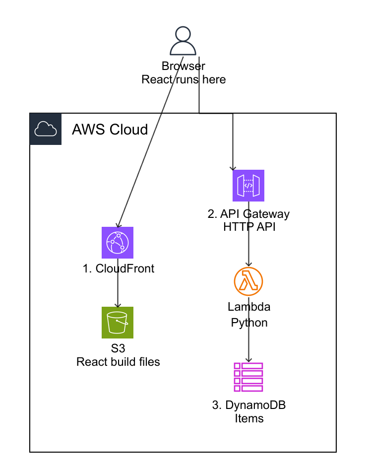

# wizway-memo-aws

実績づくり向けのサンプル。  
お題例: **雑メモボード**（DynamoDB でデータが残る）。

**React + TypeScript + Python Lambda + API Gateway (HTTP API) + DynamoDB**

| 経路 | 役割 |
|------|------|
| `GET /hello` | 疎通確認 |
| `GET/POST /items` | メモ一覧・追加（DynamoDB） |
| `DELETE /items/{id}` | メモ削除（DynamoDB） |
| `GET /demo/error?marker=印` | 演習用。`marker` をログに出してから未処理エラーになる（メモは増えない） |

永続化なしの Hello 専用サンプル:  
https://github.com/Kazuyuki-Hongo/wizway-hello-aws

## 動いている画面（デプロイ済み）

- フロント: https://d2tm7fh6nl8vai.cloudfront.net
- API（items）: https://r52vm0llrg.execute-api.ap-northeast-1.amazonaws.com/prod/items
- API（hello）: https://r52vm0llrg.execute-api.ap-northeast-1.amazonaws.com/prod/hello
- API（演習用エラー）: https://r52vm0llrg.execute-api.ap-northeast-1.amazonaws.com/prod/demo/error?marker=lesson1

上の URL は見るだけで、このスタックは変更しません。

## 構成

```
backend/          Python Lambda (/hello, /items, /demo/error)
frontend/         React + TypeScript (Vite) — メモ画面
template.yaml     SAM (HTTP API + DynamoDB + S3 + CloudFront)
samconfig.toml    デプロイ設定 (ap-northeast-1 / stack: wizway-memo-aws)
.cursor/mcp.json  AWS Serverless MCP (AWS_PROFILE は自分のプロファイル名に書き換える)
docs/             構成図
```

### `.cursor/mcp.json` の設定

AWS Serverless MCP（AWS のデプロイ操作を Agent から使えるようにする仕組み）の設定ファイルです。

- 最後の引数 `awslabs.aws-serverless-mcp-server.exe` の `.exe` は Windows 専用です。Linux / macOS では `awslabs.aws-serverless-mcp-server` に書き換えます。
- `AWS_PROFILE` の `<自分のプロファイル名>` は、自分の AWS CLI のプロファイル名に書き換えます。ファイルをコピーしてから書き換えます。

### 構成図



- 静的配信: CloudFront → S3（フロント）
- API: API Gateway → Lambda。画面の React（TypeScript）がこの API を呼ぶ
- **データが残る理由**: Lambda が **DynamoDB**（`/items`）に読み書きする

## 前提

- AWS CLI / SAM CLI / Node.js / uv
- IAM Identity Center でサインインするプロファイル（DynamoDB の権限が要る）。プロファイル名は自分で付ける

```powershell
aws sso login --profile <自分のプロファイル名>
aws sts get-caller-identity --profile <自分のプロファイル名>
```

## デプロイ手順

### 1. API + インフラ

```powershell
sam build
sam deploy --profile <自分のプロファイル名>
```

Outputs: `ApiUrl` / `ItemsEndpoint` / `ItemsTableName` / `FrontendBucketName` / `FrontendUrl` / `CloudFrontDistributionId`

### 2. フロント

`frontend/.env.production`:

```env
VITE_API_URL=https://xxxx.execute-api.ap-northeast-1.amazonaws.com/prod
```

```powershell
cd frontend
npm ci
npm run build
aws s3 sync dist/ s3://<FrontendBucketName>/ --delete --profile <自分のプロファイル名>
aws cloudfront create-invalidation --distribution-id <CloudFrontDistributionId> --paths "/*" --profile <自分のプロファイル名>
```

## ローカル確認

Windows と Linux / macOS で同じ流れです。違うのはコマンドの書き方だけで、違う箇所には両方の例を書いています。

### ローカルのデータの置き場

`sam local` で起動したとき、または環境変数 `ITEMS_TABLE` が無いときは、DynamoDB の代わりにメモリにメモを保存します。実際の DynamoDB は見ません。プロセスを再起動すると、メモは消えます。

### バックエンド（Docker がある場合）

リポジトリ直下で実行します。Docker Desktop（Linux では Docker Engine）が動いている必要があります。

```powershell
sam build
sam local start-api
```

起動すると `Running on http://127.0.0.1:3000` のように API の URL が表示されます。この URL をメモします。

Windows（PowerShell）:

```powershell
curl.exe http://127.0.0.1:3000/hello
```

Linux / macOS:

```bash
curl http://127.0.0.1:3000/hello
```

`message` と `service` を含む JSON が返れば完了です。Windows PowerShell 5.1 では `curl` が別のコマンドになるので、`curl.exe` と書きます。

### バックエンド（Docker が無い場合）

Python で `lambda_handler` を直接呼びます。リポジトリ直下で実行します。`ITEMS_TABLE` を設定せず、`boto3` も入れません。

Windows（PowerShell）:

```powershell
@'
import json, sys
sys.path.insert(0, "backend")
from app import lambda_handler

def call(method, path, body=None):
    event = {"rawPath": path, "requestContext": {"http": {"method": method}}}
    if body is not None:
        event["body"] = json.dumps(body, ensure_ascii=False)
    res = lambda_handler(event, None)
    return res["statusCode"], json.loads(res["body"])

print(call("GET", "/hello"))
print(call("POST", "/items", {"title": "最初のメモ"}))
print(call("GET", "/items"))
'@ | python -
```

Linux / macOS:

```bash
python3 - <<'EOF'
import json, sys
sys.path.insert(0, "backend")
from app import lambda_handler

def call(method, path, body=None):
    event = {"rawPath": path, "requestContext": {"http": {"method": method}}}
    if body is not None:
        event["body"] = json.dumps(body, ensure_ascii=False)
    res = lambda_handler(event, None)
    return res["statusCode"], json.loads(res["body"])

print(call("GET", "/hello"))
print(call("POST", "/items", {"title": "最初のメモ"}))
print(call("GET", "/items"))
EOF
```

`/hello` で `message` と `service` が見え、追加したメモが `/items` の一覧に出れば完了です。メモはこのコマンドを実行している間のメモリ上にだけあり、終了すると消えます。Docker が無い人のローカルの確認は、ここまでと、次の「フロント」で `npm run dev` を実行して、API が未設定のときの表示が出ることの2つです。この方法では API の URL は出ないので、画面から API を呼ぶところは、Docker を使う方法か、クラウドに載せてから確かめます。
1本目が動いたあとなら、学習パックのコースC 05（Playwright）の「Docker が無いとき」の方法でも、画面の動きを確かめられます。

### フロント

`sam local start-api` が表示した API の URL を `VITE_API_URL` に書きます。

Windows（PowerShell）:

```powershell
cd frontend
npm ci
Set-Content -Path .env.local -Value "VITE_API_URL=<表示された API の URL>"
npm run dev
```

Linux / macOS:

```bash
cd frontend
npm ci
echo "VITE_API_URL=<表示された API の URL>" > .env.local
npm run dev
```

`npm run dev` が表示する URL（例: `http://localhost:5173`）をブラウザで開きます。

Docker が無い場合は、`.env.local` を作らずに `cd frontend`、`npm ci`、`npm run dev` だけを実行します。画面に「(VITE_API_URL 未設定 — ローカル確認用)」と出れば、フロントのローカル確認は完了です。

## 関連

- Hello 専用: https://github.com/Kazuyuki-Hongo/wizway-hello-aws
- 学習パック（ページの位置は同じ。案内された入口を開く）
  - ウィズウェイ: https://github.com/Kazuyuki-Hongo/ai-utilization-pack （`04` / `06` / `07`）
  - それ以外のグループ会社: https://github.com/Kazuyuki-Hongo/ai-utilization-pack-common （`04` / `06` / `07`）
